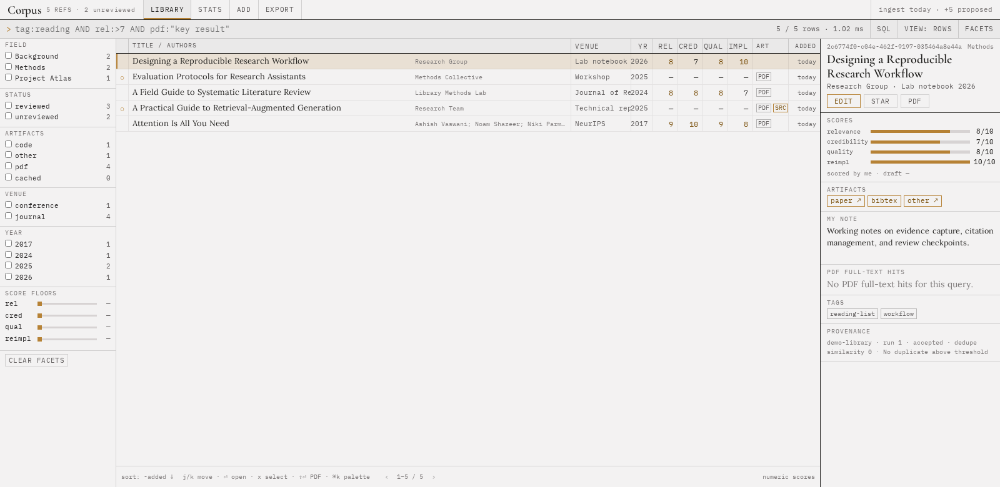

# Corpus

<p align="center">
  
</p>

<p align="center">
  <a href="https://github.com/iSach/corpus/actions/workflows/test.yml"></a>
  <a href="https://github.com/iSach/corpus/releases"></a>
  <a href="LICENSE"></a>
  <a href="https://www.python.org/"></a>
  <a href="#production-deployment"></a>
</p>

Corpus is a single-user, self-hosted research library for collecting, organizing, searching, and reviewing academic papers. Capture metadata from DOI or arXiv, add notes, tags, scores, and artifact links, cache PDFs for page-aware full-text search, and export a library you control.

Organize papers around your own projects with configurable fields. Corpus works for literature reviews, research planning, and ongoing technical reading; it makes no assumptions about your discipline or workflow.



## Highlights

- DOI and arXiv metadata lookup, plus links to PDFs, code, data, slides, and other artifacts.
- Fast title/author search, multi-project capture, bulk link lookup, and a browser bookmark button for adding papers from open tabs.
- Research topics with editable descriptions, tags, review states, numeric scores, facets, and saved smart lists.
- Fast SQLite FTS5 search across titles, authors, abstracts, notes, tags, and extracted PDF text.
- Boolean query language with score and year filters, sorting, and page-numbered PDF results.
- Background PDF caching and extraction, provenance for imported papers, and near-duplicate detection.
- An approval Inbox for automatic discoveries, with approve/dismiss, undo, topic filters, and a separate reading status.
- JSON, CSV, and BibTeX export, a bounded read-only SQL console, and a Bearer-authenticated ingest API for scripts and agents.
- One FastAPI process and SQLite database. No frontend build step or external service dependency.
- Optional daily arXiv watch in GitHub Actions; define private topic queries and send matches to the Inbox through the protected ingest API.
- Native passkey sign-in, including iCloud Keychain, with automatic sign-in attempts after registration and a password fallback.

Corpus is released under the [MIT License](LICENSE). The bundled fonts retain their respective SIL Open Font License notices in `static/fonts/`.

## Run locally

Corpus expects Python 3.10 or newer. From the repository root:

```sh
python3 -m venv .venv
.venv/bin/pip install -r requirements.txt
.venv/bin/python run.py
```

The default bind is `127.0.0.1:8000`. The first normal start creates `data/corpus.sqlite3`, the PDF cache directory, a generated ingest token at `data/ingest-token`, and, when no `CORPUS_PASSWORD` is supplied, a generated login password in `data/initial-credentials.json` with mode `0600`. Read that password once, store it in a password manager, and remove the credentials file when it is no longer needed:

```sh
jq -r .password data/initial-credentials.json
rm data/initial-credentials.json
```

New libraries start with a single `Unfiled` field. Use **Topics** in the app to add research areas and keep a full research brief with each one. Topics appear in the Add/Edit form and the library filters, including topics with no papers yet. Their stable IDs are used by the query language and ingest API as `field` values.

You can also define project areas at startup with `CORPUS_FIELDS`; for example:

```sh
export CORPUS_FIELDS='[{"id":"thesis","label":"Thesis"},{"id":"lab-notes","label":"Lab notes"},{"id":"unfiled","label":"Unfiled"}]'
```

Names explicitly listed in `CORPUS_FIELDS` are reapplied on startup. Topics added in the app and all topic descriptions persist in SQLite independently of that setting.

## Add papers quickly

Open **Add** to search by title or author, or paste a DOI, arXiv ID, or paper link into the search bar. Choose one or several projects in the left rail, then click **ADD** beside a result. Project choices stay selected across papers and reloads. Saved papers appear immediately; arXiv and Crossref results arrive independently, so one slow source does not block other matches. Recent catalog lookups are cached for ten minutes. You can limit a search to titles or authors and request more results.

Select several result checkboxes and use **ADD SELECTED**, or press **Ctrl/⌘ + Enter** to add the selection (or the focused result). New manual captures enter the library unread. Existing papers gain the selected project memberships while retaining their notes, scores, reading status, and cached files. **ADDED** means the paper already belongs to every currently selected project. Possible title duplicates offer **USE EXISTING** or **KEEP SEPARATE**; pending and dismissed suggestions require an explicit **APPROVE & ADD** or **RESTORE & ADD** action.

For many tabs, use **Paste links**: paste up to 30 URLs or identifiers, one per line, look up their metadata, review the matches, and add them together. arXiv identifiers are resolved in one grouped request. Unsupported links keep a visible error while valid matches remain addable. DOI-bearing publisher URLs are recognized without fetching arbitrary web pages.

For individual tabs, drag **SAVE TO CORPUS** from the project rail onto your browser's bookmarks bar. Click that bookmark while viewing a paper to open its Add view with the link prefilled. If the link has no recognizable identifier, its page title is used to search instead. This shortcut opens a preview and requires an explicit Add action. If a site blocks the bookmark button, paste its URL or title in Add.

**Manual entry** retains the detailed metadata, notes, scores, and artifact editor. Existing paper edits also support multiple project checkboxes. On phones, **PROJECTS** opens the project selector and tapping a result reveals its abstract.

Projects use the existing topic IDs. `papers.field` remains the primary topic for compatibility and topic-specific assessments; `paper_projects` records all memberships. Both `field:` and `project:` search all memberships, and project filters, statistics, JSON/CSV/BibTeX exports include secondary projects without duplicating a paper in the library total.

The repository includes an example **Uncertainty calibration** topic that shows the shape of a research brief and its relevance criteria. It is in [topics/uncertainty-calibration.json](topics/uncertainty-calibration.json); copy it as a starting point for your own topics. Add or update a topic file in the configured library with:

```sh
.venv/bin/python -m corpus.topics topics/uncertainty-calibration.json
```

The command uses the same environment configuration as the server and can be repeated without creating duplicate topics. It adds the topic without importing papers or changing existing paper assignments.

An optional, verified 34-paper library is available as a demonstration dataset. It covers simulation-based inference and diffusion models, but it does not define Corpus's default workflow. Run `seed.py` to add it; it is filed under your generic default unless you configure matching field IDs. Seed PDFs remain linked but are not downloaded unless you pass `--cache-pdfs`. The command is idempotent:

```sh
.venv/bin/python seed.py --cache-pdfs
```

PDF full-text search becomes available only after a PDF has been cached and extracted. A failed or pending download is visible in Stats and can be retried from the artifact controls.

For a login-free development session, use a loopback bind explicitly:

```sh
.venv/bin/python run.py --dev --host 127.0.0.1
```

`--dev` and `CORPUS_DEV=1` are rejected on non-loopback binds.

## Configuration

The process reads environment variables directly; it does not load a `.env` file itself. For a local file, use `set -a; . ./.env; set +a` before starting. For production, use the `EnvironmentFile` in `docs/corpus.service`. See [.env.example](.env.example) for a shell-compatible template.

| Variable | Default | Purpose |
| --- | --- | --- |
| `CORPUS_DATA_DIR` | `./data` | SQLite database and generated credentials/token files. |
| `CORPUS_PDF_CACHE` | `$CORPUS_DATA_DIR/pdfs` | Directory for cached PDFs. |
| `CORPUS_CACHE_MAX_BYTES` | `10737418240` | PDF cache quota, 10 GiB by default. |
| `CORPUS_DEDUPE_THRESHOLD` | `0.91` | Fuzzy title/author duplicate threshold, from `0.5` through `1`. Exact DOI and arXiv matches always win. |
| `CORPUS_FIELDS` | one `Unfiled` field | JSON list of `{ "id": ..., "label": ... }` field definitions. Define your own project areas; existing field IDs are retained when labels change. |
| `CORPUS_PASSWORD` | empty | Login password. Set this in production to avoid generated credentials; changing it and restarting rotates the stored password and ends in-memory sessions. |
| `CORPUS_INGEST_TOKEN` | generated file token | Bearer token for `POST /api/ingest`. If omitted, the token is generated in `data/ingest-token` with mode `0600`. |
| `CORPUS_SQL_LOCAL_ONLY` | `0` | Set to `1` to allow the SQL console only when the resolved client address is loopback. |
| `CORPUS_SECURE_COOKIE` | `0` | Set to `1` when the app is served through HTTPS. |
| `CORPUS_PASSKEY_ORIGIN` | empty (disabled) | Exact public HTTPS origin, such as `https://literature.example.org`. The hostname becomes the passkey relying-party ID. Only `http://localhost:PORT` is allowed for local passkey development. |
| `CORPUS_DEV` | `0` | Disable login for loopback development only. Prefer `run.py --dev`. |

Each PDF download is bounded to 50 MiB, each extracted PDF to 1,000 pages and 20 million characters, and request bodies to 2 MiB. The cache quota is checked before a download begins.

## Passkey sign-in

Set `CORPUS_PASSKEY_ORIGIN` to the site's HTTPS origin, enable `CORPUS_SECURE_COOKIE=1`, and restart Corpus. Sign in with your password, open **PASSKEYS**, enter your current password, and choose **ADD PASSKEY**. On Apple devices, save the passkey with iCloud Keychain; Apple describes its device and syncing support in the [passkeys overview](https://developer.apple.com/passkeys/). The browser and operating system choose the passkey provider; Corpus does not require an Apple account integration.

Once a passkey has been registered, the sign-in page automatically tries it once on a subsequent signed-out visit. Canceling, choosing **USE PASSWORD**, or using an unsupported browser leaves password sign-in available. **SIGN IN WITH PASSKEY** retries manually. An explicit logout stays signed out until another visit or a manual sign-in.

Adding or removing passkeys requires both a signed-in session and the current password. Registration requests a discoverable passkey and device verification; every sign-in verifies the challenge, signature, exact origin, relying-party ID, and user verification. Challenges expire after five minutes, can be used once, and are bound to the requesting browser. Synced passkeys with zero signature counters are supported.

The SQLite database retains only public credential material and metadata; the private key stays with the authenticator. Include the database in backups to retain registered passkeys. Keep the configured hostname stable: passkeys created for another hostname must be registered again at the new address. The existing password remains the recovery method.

## Approval Inbox

Automatic submissions through `/api/ingest` enter **Inbox → Pending**. They appear in the Inbox badge and screening views while waiting for your decision. Library search, library statistics, saved query lists, and exports include approved papers only. Papers added by hand and the optional seed library are approved immediately.

The Inbox shows why a paper fits, its relevance, role, assessment confidence, evidence level, source version, and important limitation before approval. Importer scores and discovery queries remain separate from source-grounded assessments. Older imports without an assessment say **Awaiting assessment**. Filter by topic, evidence, existing/new discoveries, or search. The example Uncertainty calibration topic includes screening criteria and explanation guidance in [topics/uncertainty-calibration-criteria.md](topics/uncertainty-calibration-criteria.md); each topic keeps its own editable criteria in **Topics**.

Use **APPROVE FROM ABSTRACT**, **APPROVE & NEXT** after a completed full-text check, **DISMISS & NEXT**, or **LATER**. Later sets a paper aside for 24 hours, survives reloads, and remains accessible in the Later tab. Approval records the assessment displayed when you decided, admits the paper to the library, and queues its PDFs. It leaves the paper unread and does not accept proposed scores as your personal ratings. Dismissals are remembered by duplicate detection, so future submissions of the same paper do not refill the queue.

**ASSESS ABSTRACT** records a topic-specific judgment without changing admission. High-relevance abstract assessments and explicit decision-relevant questions automatically prepare the linked PDF; **CHECK FULL TEXT** requests preparation for other candidates. This uses the existing bounded downloader and cache without admitting the paper to search, library statistics, or exports. Preparing a PDF is not a completed scientific assessment: the card shows **Full text ready to inspect** until you or the discovery agent records a check. **RECORD FULL-TEXT CHECK** opens extracted pages and requires sections inspected plus a supporting passage that occurs on its cited page. The original abstract explanation, earlier assessments, and source snapshots are preserved. Source or topic-criteria changes invalidate the current assessment rather than silently reusing it. Explicit arXiv revisions must match the linked PDF. Unspecified source versions remain visibly unspecified.

No model service is bundled or implicitly called. Scientific explanations come from the owner or discovery agent through the structured interface described in [INGEST.md](INGEST.md). Agents can retrieve work and page text and append assessments; their token cannot make admission decisions. An unavailable PDF never blocks approval from the abstract, and a later assessment never silently reverses an approval.

**UNDO LAST DECISION** reverses a decision unless the paper has since changed. **Dismissed** keeps rejected suggestions available for restoration; **Approved** shows the history of admitted discoveries. You can edit a pending paper's details without approving it. Keyboard shortcuts are `a` to approve, `d` to dismiss, `j`/`k` to move, and `u` to undo. The Inbox and badge refresh every minute while visible, and when you return to the app.

Existing libraries retain their papers when the migration runs. To explicitly move unreviewed imports from one agent into the Inbox, using the server's environment configuration:

```sh
.venv/bin/python -m corpus.inbox --stage-agent corpus-arxiv-watch/1.0
```

The command preserves notes, scores, project assignments, and cached files. It pauses unfinished PDF downloads for those candidates and skips reviewed papers or papers with earlier Inbox decisions, so it is safe to repeat.

## API overview

The browser uses these routes:

- `GET /api/config`, `GET /api/session`, `POST /api/login`, and `POST /api/logout` handle configuration and the seven-day in-memory session cookie.
- `GET /api/passkeys` lists registered keys; `POST /api/passkeys/register/options` and `/register/verify` register a key after password confirmation; `POST /api/passkeys/{id}/remove` removes one after password confirmation. `POST /api/passkeys/authenticate/options` and `/authenticate/verify` are the public passkey sign-in endpoints and issue the same session cookie as password login.
- `GET /api/papers` searches the library; `GET /api/paper?id=...` returns detail, provenance, and PDF hits; `POST /api/papers` creates or updates a paper; `POST /api/duplicates` returns near-duplicate candidates.
- `GET /api/inbox` lists discoveries by `status` (`pending`, `later`, `approved`, or `dismissed`), `field`, `q`, `evidence`, `origin`, and `sort` (`relevance`, `newest`, or `oldest`). `POST /api/inbox/decision` takes `{ "id": ..., "action": "approve" | "dismiss" | "restore" | "return" | "defer" | "resume", "expected_modified": ..., "assessment_id": ... }`; `POST /api/inbox/undo` takes `{ "decision_id": ... }`. All require an interactive session, and the ingest token cannot make approval decisions.
- `POST /api/review/check` prepares a PDF before admission; `GET /api/review/text` reads one extracted page; `POST /api/review/assessments` appends a structured abstract or full-text assessment; `GET /api/review/work` returns candidates awaiting assessment or prepared checks, including checks that finish after early approval. The last three routes also accept the ingest token. Assessments are independent of library admission and personal scores.
- `POST /api/metadata` fetches DOI or arXiv metadata; it accepts an identifier or source URL containing one of those identifiers.
- `GET /api/catalog/search?q=...&source=library|crossref|arxiv&mode=all|title|author&offset=0` searches saved papers or a public catalog. `POST /api/catalog/resolve` accepts `{ "identifiers": [...] }` and returns per-link metadata or errors. `POST /api/capture` takes `{ "projects": [...], "papers": [...], "query": ... }` and adds or files up to 50 selected papers per request. These routes require a browser session; the ingest token cannot use manual capture.
- `GET /api/topics` lists topics, research descriptions, and relevance criteria; `POST /api/topics` creates or updates `{ "id": ..., "label": ..., "description": ..., "relevance_criteria": ... }`. Both routes require a session. Descriptions and criteria are omitted from the public configuration response.
- `GET /api/stats`, `POST /api/export`, and the smart-list routes support review and export workflows. `POST /api/artifacts/{id}/cache` queues a linked or failed PDF from the detail pane; `POST /api/artifacts/{id}/retry` is an alias that supports the same linked/failed states.
- `POST /api/sql` runs a bounded read-only query. SQLite is opened in read-only mode with `query_only`, an authorizer, a 150 ms progress timeout, and a 1,000-row cap. `CORPUS_SQL_LOCAL_ONLY=1` adds a loopback client check.
- `POST /api/ingest` is the agent-facing endpoint and is authenticated with the Bearer token described in [INGEST.md](INGEST.md).
  The included [scheduled paper watch](docs/paper-watch.md) discovers arXiv matches for your GitHub-configured topics and sends them there.

The production systemd and nginx templates are [docs/corpus.service](docs/corpus.service) and [docs/nginx.conf](docs/nginx.conf). They keep Uvicorn on loopback, run one non-root process, and put TLS and the public listener in nginx.

## Query language

The query bar accepts bare terms and these filters:

```text
field:thesis        tag:to-read           venue:ICML  author:Raymond
year:2025           rel:>7                state:unreviewed
has:code            has:pdf              has:cached
is:starred          pdf:"posterior collapse"
sort:rel            sort:-added
```

Bare terms search title, authors, abstract, tags, and notes. Score names are `rel`, `cred`, `qual`, and `reimpl`; score and year filters accept `=`, `<`, `<=`, `>`, and `>=`. `AND`, `OR`, `NOT`, parentheses, and implicit `AND` are supported, with precedence `NOT`, then `AND`/implicit adjacency, then `OR`. A query can contain one top-level sort directive. Score sorts are descending; `added`, `modified`, `year`, `title`, and `venue` follow the requested direction. `pdf:` searches extracted page text and the detail pane reports page-numbered snippets.

Invalid syntax returns a structured error from the API. The client keeps the previous result set and displays the parse message and position, so a mistyped query does not clear the library view.

## Production deployment

Create a dedicated non-root account and directories, install the repository and virtual environment under `/opt/corpus`, and store data under `/var/lib/corpus`:

```sh
sudo useradd --system --home /var/lib/corpus --shell /usr/sbin/nologin corpus
sudo install -d -o corpus -g corpus /var/lib/corpus/data /var/lib/corpus/data/pdfs
sudo install -d -o root -g corpus -m 0750 /etc/corpus
sudo install -o root -g corpus -m 0640 .env.example /etc/corpus/corpus.env
sudoedit /etc/corpus/corpus.env
```

Replace every secret and placeholder in the environment file. Set `CORPUS_SECURE_COOKIE=1` and choose an absolute `CORPUS_DATA_DIR`. Leave `CORPUS_SQL_LOCAL_ONLY=0` when the normal login gate is sufficient. Set it to `1` when the SQL console must be reachable only from loopback: because nginx overwrites `X-Forwarded-For` with the real client address and Uvicorn trusts forwarded headers only from loopback, remote requests through nginx are blocked. Use an SSH tunnel or a local browser on the host for SQL access in that mode. Install and enable the unit:

```sh
sudo install -o root -g root -m 0644 docs/corpus.service /etc/systemd/system/corpus.service
sudo systemctl daemon-reload
sudo systemctl enable --now corpus
sudo journalctl -u corpus -f
```

Copy `docs/nginx.conf` into the nginx site configuration, replace `literature.example.org` and the certificate paths, enable the site, validate it, and reload nginx. The template overwrites `X-Forwarded-For` with `$remote_addr`; this is required because `run.py` trusts forwarded headers only from its loopback proxy. Do not expose port 8000 directly or add public addresses to `forwarded_allow_ips`.

## Backup and restore

### Nightly database backups

`scripts/backup_db.py` copies the database with SQLite's online backup API, so the copy is consistent while Corpus keeps running. Each run writes `corpus-YYYYMMDDTHHMMSSZ.sqlite3` (UTC) through a temporary file, runs `PRAGMA integrity_check` on the copy, renames it into place, then deletes all but the newest `--keep` snapshots (default 14). If the check fails, the run exits non-zero, removes the partial copy and prunes nothing. Other files in the backup directory are never touched.

The PDF cache is not included. Extracted PDF text is stored in the database, so search keeps working after a restore; the PDF files can be fetched again from their source links, or kept with the full backup below.

Install the templates, after adjusting paths and `--keep` in the service file if your layout differs:

```sh
sudo install -d -o corpus -g corpus -m 0750 /var/backups/corpus
sudo install -o root -g root -m 0644 docs/corpus-backup.service docs/corpus-backup.timer /etc/systemd/system/
sudo systemctl daemon-reload
sudo systemctl enable --now corpus-backup.timer
sudo systemctl start corpus-backup.service
systemctl list-timers corpus-backup.timer
journalctl -u corpus-backup -n 5
```

The timer runs at 03:15 server time with up to 15 minutes of random delay; `Persistent=true` catches up on a run missed while the machine was off. A failed run shows in `systemctl status corpus-backup` and the journal. Run the script only as `corpus`: reading a WAL database creates `-wal` and `-shm` files owned by the reader, and root-owned ones would stop the server from writing, so the script refuses to run as anyone but the database owner. Backups on the same disk do not survive losing that disk; copy `/var/backups/corpus` to another machine as well.

Check a backup without changing it:

```sh
sudo -u corpus /opt/corpus/.venv/bin/python /opt/corpus/scripts/backup_db.py --verify /var/backups/corpus/corpus-20260101T031500Z.sqlite3
```

### Restore a nightly backup

Stop Corpus, snapshot the current state so the restore can be undone, clear the old WAL files, then put the chosen backup in place:

```sh
sudo systemctl stop corpus
sudo -u corpus /opt/corpus/.venv/bin/python /opt/corpus/scripts/backup_db.py --database /var/lib/corpus/data/corpus.sqlite3 --dest /var/backups/corpus/pre-restore
sudo rm -f /var/lib/corpus/data/corpus.sqlite3-wal /var/lib/corpus/data/corpus.sqlite3-shm
sudo install -o corpus -g corpus -m 0640 /var/backups/corpus/corpus-20260101T031500Z.sqlite3 /var/lib/corpus/data/corpus.sqlite3
sudo systemctl start corpus
```

Delete the `-wal` and `-shm` files only after the snapshot: they can hold the stopped server's last writes, and SQLite would apply a leftover WAL file to the restored database.

### Full offline backup

To keep the PDF cache as well, stop Corpus and copy the database and PDF cache together. This avoids coordinating a live WAL database with files whose extraction status is changing:

```sh
sudo systemctl stop corpus
sudo install -d -m 700 /var/backups/corpus-full
sudo sqlite3 /var/lib/corpus/data/corpus.sqlite3 ".backup '/var/backups/corpus-full/corpus.sqlite3'"
sudo tar -C /var/lib/corpus/data -czf /var/backups/corpus-full/pdfs.tgz pdfs
sudo cp -a /var/lib/corpus/data/ingest-token /var/backups/corpus-full/ingest-token
sudo systemctl start corpus
```

Without the `sqlite3` command-line tool, make the database copy with `scripts/backup_db.py` run as `corpus`, as above. Keep the database backup and matching PDF cache archive from the same stopped-server window. Protect both backups because the token file authorizes agent writes.

The `sqlite3`, `tar`, and `cp` commands above copy files without printing database or token contents. If `CORPUS_PASSWORD` or `CORPUS_INGEST_TOKEN` lives in `/etc/corpus/corpus.env`, preserve that file through a protected secret-backup mechanism rather than echoing its values; retain restrictive file permissions.

To restore a full backup, stop the service, replace `corpus.sqlite3` and the `pdfs` directory from the matching backup, restore the token if agent continuity matters, fix ownership to `corpus:corpus`, and start the service. Do not restore while the process is running; remove stale `corpus.sqlite3-wal` and `corpus.sqlite3-shm` files only after confirming they are from the old stopped instance.
